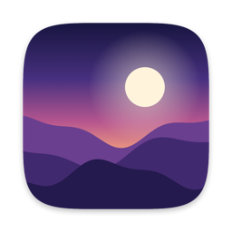
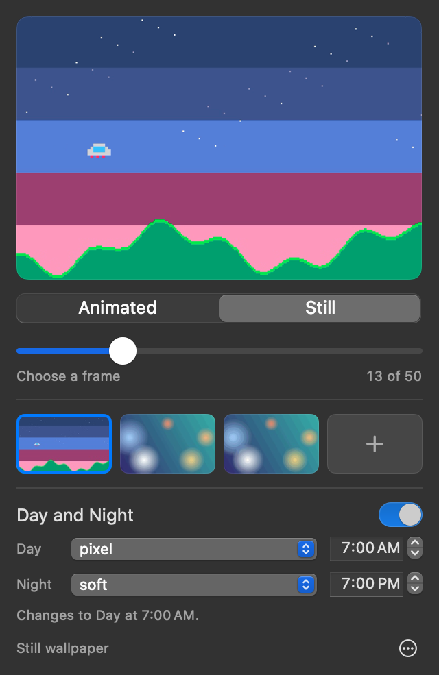
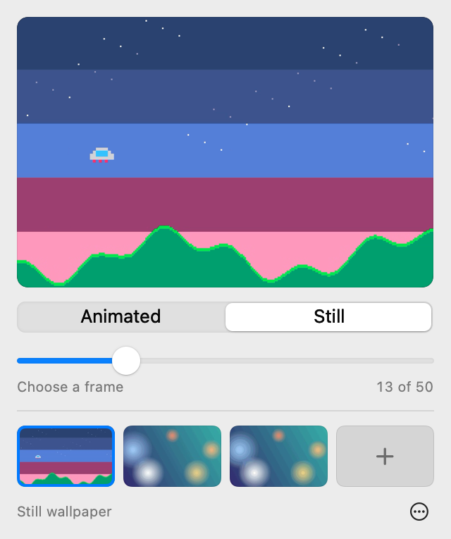

<p align="center"></p>

<h1 align="center">Lull</h1>

<p align="center">GIFs and looping videos as your Mac wallpaper. It rests when nobody's looking.</p>

<p align="center">
  <a href="https://github.com/markoderic/lull/releases/latest/download/Lull.dmg"></a>
</p>

<p align="center">It's free, with no account and no ads. It needs a Mac with an M1 chip or newer, on macOS 15.4 or later.</p>

## Install

1. Open **Lull.dmg** from your Downloads folder.
2. Drag Lull onto Applications.
3. Open Lull from Applications, and click **Open** when your Mac asks. A small panel appears from a new icon at the top right of your screen. Drop a GIF or video onto it, and it's your wallpaper.

If you open Lull straight from the installer window, it offers to move itself to Applications. There's also a [step-by-step guide with pictures](https://markoderic.github.io/lull/#install).

Lull is signed with a Developer ID and notarized by Apple, which scans it for malware. Your Mac asks about anything downloaded from the internet the first time you open it. To confirm you have the real file, compare it with the checksum published with each release:

```bash
shasum -a 256 ~/Downloads/Lull.dmg
```

## What it is

Lull is a very light menu bar app for macOS. Drag in a GIF or video you already have and it becomes your wallpaper, behind your desktop icons. When you can't see the wallpaper, Lull stops doing work: the video player is fully unloaded and CPU use drops to zero.

It's a 2 MB native app with no accounts, analytics or network use. Free and open source under the MIT license.

<p align="center">
  
  
</p>

## Features

- **GIFs, MP4 and MOV.** Each file is prepared once, then played on your Mac's video hardware.
- **Desktop Focus or Whenever Visible.** With Desktop Focus, the default, the wallpaper plays only after you click the desktop and freezes as soon as you use another app. With Whenever Visible, it keeps playing around your windows and pauses only when they cover the whole desktop.
- **Still or Animated.** Freeze any wallpaper and drag a slider to pick the exact frame. Your desktop updates as you drag.
- **Smooth Motion.** Generates in-between frames for GIFs and videos, up to 120 FPS, using Apple's frame rate conversion. It runs once and the result is saved.
- **Speed.** Slow any animation down to a quarter speed, or speed it up to double. It's instant, because nothing needs converting.
- **Frame limits.** Lower a fast video to 60 or 30 FPS to save power.
- **Day and Night.** Add two wallpapers, like a light and a dark version of the same scene, and choose the times they take over. Lull crossfades between them, and catches up if your Mac was asleep at the time.
- **Sharp pixel art.** Small GIFs are enlarged before encoding so pixel art stays crisp.
- **Fit to Screen.** Converts a file that doesn't match your screen, like a vertical video, to your exact resolution. The whole picture is centered, with a blurred copy of it filling the rest.
- **Multiple displays.** One wallpaper across every screen, decoded once.

Your real wallpaper setting is never changed. Quit Lull and your normal wallpaper is back.

## Build from source

```bash
git clone https://github.com/markoderic/lull.git
cd lull
scripts/build-app.sh
open dist/release/Lull.app
```

You need Xcode 26 or later. There's no Xcode project to generate: it's a Swift package, and `Package.swift` opens directly in Xcode.

## Cleaning up

To remove one wallpaper, right-click it. To remove several, choose **Clean Up Library…** from the "…" menu, select the ones you want gone, and see how much space that frees. Deleted wallpapers go to the Trash, along with all of their prepared versions. Your own original files aren't touched.

## Choosing a file

Wallpapers fill your screen, so a file looks best when it matches your screen's shape and resolution. When you have no wallpapers yet, the panel shows the best size for your screen. It also tells you if a file you add will be cropped or look soft.

| Your screen | Best size |
|---|---|
| MacBook Air 13-inch | 2560 × 1664 |
| MacBook Air 15-inch | 2880 × 1864 |
| MacBook Pro 14-inch | 3024 × 1964 |
| MacBook Pro 16-inch | 3456 × 2234 |
| iMac 24-inch | 4480 × 2520 |
| Studio Display, 5K | 5120 × 2880 |
| 4K display | 3840 × 2160 |

These are the native resolutions. If you've changed your display scaling, the size shown in the panel will differ.

- **1920 × 1080 is a good lighter choice.** It's close enough in shape to any landscape screen and uses far less memory than 4K.
- **Vertical videos get zoomed in,** which hides much of the picture on a landscape screen. Turn on Fit to Screen to see all of it. It keeps every frame, but makes a larger file. In one test, a 29-second, 23 MB vertical video took 18 seconds to convert and came out at 115 MB, with CPU use about the same as before.
- **Converting can't add detail.** A small file enlarged to your screen's resolution still looks soft, so Fit to Screen is only offered when part of the picture is hidden.

## How light is it?

Measured on the release build on an M5 Pro MacBook Pro with macOS 27. CPU figures are percentages of one core, and this chip has 18. WindowServer is the system process that draws everything on screen, and it sat around 4–5% before Lull did anything.

| What's on screen | Lull | Video decoder | WindowServer | Lull's memory | Decoder's memory |
|---|---|---|---|---|---|
| Paused, another app focused | 0.00% | 0% | no added load | 16 MB | up to 36 MB |
| Paused, Finder focused but windows cover the desktop | 0.49% | 0% | no added load | same as paused | same as paused |
| Paused, covered, on Whenever Visible | 0.20% | 0% | no added load | same as paused | same as paused |
| Still wallpaper | 0.00% | 0% | no added load | 24 MB | none |
| GIF at its own 12.5 FPS | 1.1% | 0.8% | 9.6% | 21 MB | 23 MB |
| 1080p video, 30 FPS | 1.6% | 1.7% | 13.4% | 28 MB | 51 MB |
| GIF with Smooth Motion, 120 FPS | 3.6% | 4.3% | 44.6% | 22 MB | 55 MB |
| 4K video, 120 FPS | 4.1% | 7.0% | 44.9% | 56 MB | 430 MB |

Two honest notes:

- **120 FPS is the expensive part.** It keeps WindowServer redrawing the screen 120 times a second, whatever the resolution. That's why Smooth Motion is off by default and the 120 option says it uses more power.
- **Memory grows a little after Smooth Motion.** The Neural Engine holds on to about 13 MB until you quit, so Lull can sit around 36 MB after using it. A still wallpaper with no Smooth Motion stays closer to 24 MB.

These are from one Mac and a small number of samples, so treat them as a guide. Battery life and slower Macs haven't been measured yet.

## How it works

macOS has no public way to set an animated wallpaper, only still images. Lull places a borderless window at the desktop window level, which sits above the real wallpaper and below your icons, and ignores all clicks.

GIF is a costly format to play directly, because it's decoded on the CPU. So Lull converts each file once, on import, to an efficient HEVC video, and from then on Apple's standard player runs it on the video hardware. One player feeds every display.

Day and Night uses a single timer set for the next change, so it does no work in between.

To decide when to play, Lull listens for system events such as focus changes, locking and sleep. It works out whether the desktop is covered from window positions, because `NSWindow.occlusionState` proved unreliable in testing. That check runs every 2 seconds, and only when its answer could change anything.

The design and the evidence behind it are in [the design spec](docs/superpowers/specs/2026-11-06-lull-design.md).

## Known limitations

- **Desktop only.** The lock screen shows your normal wallpaper.
- **Menu bar colors follow your real wallpaper.** macOS picks the menu bar's text color from it, without knowing about the animation on top. A wallpaper that's much lighter or darker than your real one can make menu bar text harder to read.
- **Maximized and full-screen windows count as covering the desktop,** including translucent ones, so the wallpaper pauses behind them in either mode. To see the difference between the modes, use a window that leaves part of the desktop showing.
- **WebM isn't supported,** because Apple's video frameworks don't reliably open it.
- **Smooth Motion has limits.** Thin lines can wobble in generated frames, and hard cuts become a very quick dissolve.

## Not yet tested

Automated and hands-on checks ran on one Mac with one display. These haven't been tried yet:

- More than one display
- More than one Space
- Day and Night across a real sleep and wake (the logic is tested, but not on a sleeping Mac)
- macOS versions older than 27
- Battery life and slower Macs

If you try any of them, an issue saying how it went would help.

## Development

```bash
swift test               # unit and integration tests
python3 scripts/e2e/run.py   # end-to-end checks on your real desktop
```

The end-to-end checks drive a debug build against a throwaway library, so your own wallpapers aren't touched. They take over your screen for a few minutes and need `ffmpeg` to generate test files. The automation they use is compiled only into debug builds.

| Path | What's there |
|---|---|
| `Sources/LullCore` | Everything testable without a UI: importing, Smooth Motion, the library, the pause rule, coverage |
| `Sources/Lull` | The app: wallpaper engine, playback monitor, menu bar panel |
| `Tests/LullCoreTests` | Unit and integration tests, using real files and real encoders |
| `scripts/` | Build, release, icon and end-to-end tooling |

Lull has no third-party dependencies, and that's on purpose.

## License

[MIT](LICENSE)
